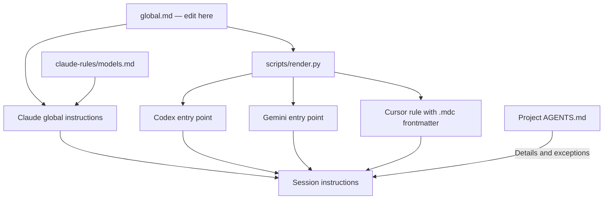

# Agent policies

My personal instructions for **Codex, Claude Code, Gemini CLI, and Cursor**, with
one shared source of truth and project-specific instructions alongside the code.
This repository was previously named `claude-policies`; its Git history is retained.

## Where to change a policy

| What you want to change | File to edit |
| --- | --- |
| Defaults for every agent and project | `global.md` |
| Claude's subagent model choices | `claude-rules/models.md` |
| Commands, conventions, or exceptions for one project | That project's `AGENTS.md` |

The local checkout is `~/.config/agent-policies`. Start with
`~/.config/agent-policies/global.md` to see the current shared policy.

**Edit the source files, then render.** The files under `agents/` are generated;
do not edit the shared policy inside those copies.

## How it works



The installer links each agent's recognized instruction location to this checkout:

| Agent entry point | Target in this repository |
| --- | --- |
| `~/.codex/AGENTS.md` | `agents/codex.md` |
| `~/.claude/CLAUDE.md` | `global.md` |
| `~/.claude/rules` | `claude-rules/` |
| `~/.gemini/GEMINI.md` | `agents/gemini.md` |
| `~/.cursor/rules/global.mdc` | `agents/cursor.mdc` |

Claude reads the shared source directly, plus its model-specific rule. Codex and
Gemini receive complete generated files, including the preserved Pushary
instructions. Cursor receives a generated rule with `alwaysApply: true`.
The installer also enables Gemini discovery of `AGENTS.md` alongside `GEMINI.md`.

Project instructions add commands, domain conventions, and exceptions. Keep them
self-contained so collaborators and cloud sessions can use the repository without
this personal checkout. Explicit user instructions take priority over these
personal defaults; tool permissions and host policies still apply.

## Set up a machine

Requirements: Git, Python 3, and a filesystem that supports symbolic links.
The setup is intended for macOS and Linux. Windows symlink permissions and agent
paths need separate consideration. Each agent is installed and signed in separately;
this repository installs instructions, not the agent applications.

### 1. Get the repository

```sh
mkdir -p ~/.config
git clone https://github.com/idonov8/agent-policies.git ~/.config/agent-policies
cd ~/.config/agent-policies
```

For authenticated SSH access instead, use
`git@github.com:idonov8/agent-policies.git` as the clone URL. Pushing changes requires
write access and Git authentication.

If this checkout already exists, use the update instructions below rather than
cloning over it. If migrating from the old `~/.claude/rules` Git checkout, preserve
any local commits or custom rules before installing; the installer archives that
directory but does not merge arbitrary extra rules into the new shared policy.

### 2. Review and install

Read `global.md` and `claude-rules/models.md` before installing: these are personal
preferences, including publishing and commit behavior.

```sh
python3 scripts/render.py --check
python3 scripts/install.py
```

The installer:

- Creates the five links listed above.
- Replaces existing entries after backing them up under
  `~/.local/state/agent-policies/backups/<timestamp>/`.
- Archives an existing Claude rules directory intact, including its Git history.
- Preserves Gemini's other settings, credentials, and hooks while adding
  `AGENTS.md` to its context filenames.
- Refuses to install if an existing Codex or Gemini managed Pushary block differs
  from the one preserved in this repository.

It prints the backup path. `manifest.json` records which entries existed and where
their originals were saved. Keep those backups outside Git. To restore, compare
current entries with the manifest, preserve any later edits, then restore each
original file, directory, or symlink. The installer itself has no automatic undo
command.

### 3. Reload and check

Start fresh agent sessions or reload their instruction context:

- **Codex:** inspect the instruction sources loaded in a new session.
- **Claude:** use `/context` and check its memory files.
- **Gemini:** use `/memory show` when Gemini CLI is installed.
- **Cursor:** inspect the enabled global rule and the project's instruction files.

Cursor account/team rules and other agent configuration may supply additional
instructions. This checkout does not replace those settings.

## Change the shared policy and publish it

```sh
cd ~/.config/agent-policies
# Edit global.md or claude-rules/models.md in your editor.
python3 scripts/render.py
python3 scripts/render.py --check
git diff
# Review new files as well with git status.
git status --short
git add global.md claude-rules agents
git commit -m "Update shared agent policies"
git push origin main
```

Commit source and generated files together. If you change the README, installer,
or integration sources, review and stage those specific files too. No website or
application deployment is part of this repository's update workflow.

Symlinks point at local files, so committing or pushing is not required for local
use. Claude sees edits to `global.md` directly on disk; the other agents see shared
policy changes after rendering. Existing sessions may retain old context until
reloaded. Pushing synchronizes the reviewed policy to GitHub for other machines.

## Update another machine

With a clean checkout:

```sh
cd ~/.config/agent-policies
git pull --ff-only
python3 scripts/render.py --check
```

Reload your agent sessions. There is no need to reinstall the links for ordinary
policy changes. If the installer or link structure changes, review those changes
before running `python3 scripts/install.py` again. If Git reports local changes,
review and commit or otherwise preserve them before pulling; do not reset them
away just to update.

## Set up a project

Put shared project guidance in a tracked `AGENTS.md` at the repository root.
Use nested `AGENTS.md` files for directory-specific guidance where supported.
Keep local machine paths and personal credentials out of project policies.

On macOS/Linux, a project needing a Claude entry point can use a relative link:

```sh
# From the project root, after creating AGENTS.md.
# Only do this if CLAUDE.md does not already exist.
ln -s AGENTS.md CLAUDE.md
git add AGENTS.md CLAUDE.md
```

If `CLAUDE.md` already contains useful or generated instructions, retain them and
add an explicit `@AGENTS.md` import instead. An import also suits collaborators
who cannot use symlinks. A Markdown link saying “see AGENTS.md” is not the same as
an explicit import.

## Pushary and managed instructions

`integrations/pushary/` preserves the existing app-managed instruction blocks.
Do not rewrite their wording by hand. The renderer includes them unchanged in
the Codex and Gemini entry points. Their presence does not install Pushary,
configure its tools, or sign in to it; the app owns that setup separately.
Credentials, hooks, and service configuration stay in local agent settings.

If the Pushary app changes a managed block, rendering stops rather than replacing
it with an older copy. Preserve the new block byte for byte in its matching
integration source, review that update, then render again. If an app replaces an
installed symlink with a regular file, compare the contents before reinstalling.
Never overwrite newer managed instructions with an older repository copy.

## Repository layout

```text
agent-policies/
├── global.md                   # Shared policy: edit here
├── claude-rules/
│   └── models.md               # Claude-specific model choices
├── integrations/pushary/
│   ├── codex.md                # Preserved managed instructions
│   └── gemini.md
├── agents/                     # Generated; committed alongside sources
│   ├── codex.md
│   ├── gemini.md
│   └── cursor.mdc
├── scripts/
│   ├── render.py               # Build entry points; --check detects drift
│   └── install.py              # Back up existing entries and install links
└── README.md
```

The migration retains the earlier policy history, including the previously
local-only model-selection change. Project-specific migrations remain separate
changes in their respective application repositories.
